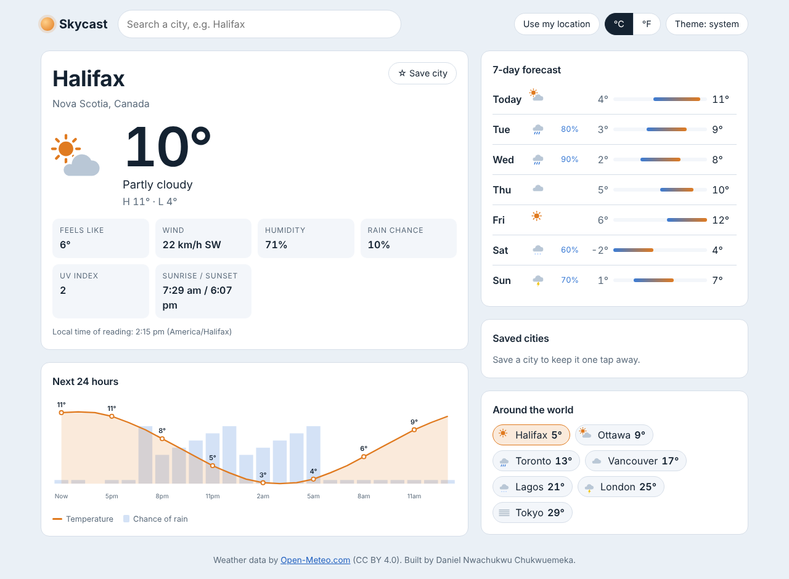

# Skycast

[](https://github.com/Dremo-drizzy/skycast/actions/workflows/ci.yml)

A fast, accessible weather dashboard for any city in the world: current conditions, a 24-hour temperature and rain chart, and a 7-day forecast. It needs no API key and no sign-up.

**Live demo:** https://dremo-drizzy.github.io/skycast/



## Features

- **City search with suggestions.** Results are debounced and cached. The search box is a full ARIA combobox: use ↑/↓ to move, Enter to pick and Esc to close.
- **Current conditions:**
  - temperature, feels-like, wind speed and direction, and humidity
  - chance of rain, UV index, and sunrise/sunset in the city's own local time
- **24-hour chart.** The SVG chart overlays temperature and rain probability. Screen readers get the same data from a hidden table.
- **7-day forecast.** Each day's high and low is drawn on a range bar scaled across the week.
- **Saved cities and a world strip.** All their temperatures come from **one** API request, not one per city.
- **°C/°F and light, dark or system theme.** These preferences are remembered.
- **Shareable URLs.** For example, `?place=Ottawa&lat=45.4112&lon=-75.6981`. The back and forward buttons move between cities.
- **"Use my location"** via the browser Geolocation API, with clear messages when location is denied or unavailable.
- **Loading skeletons and friendly error states** with a retry button. It works on a 320 px phone screen.

## Tech stack

| Area | Choice | Why |
| --- | --- | --- |
| UI | React 19 + TypeScript (strict) | Typed API responses catch mapping mistakes at compile time |
| Data fetching | TanStack Query 5 | Caching, request de-duplication, cancellation and retries without hand-written effects |
| Weather data | [Open-Meteo](https://open-meteo.com/) | Free, HTTPS and CORS-enabled, and needs no key, so no secret is ever shipped to the browser |
| Build | Vite 6 | Fast dev server and small production bundle (~88 kB gzipped JS) |
| Tests | Vitest, Testing Library, MSW | Tests run against mocked HTTP, so they are fast and never hit the real API |
| CI/CD | GitHub Actions → GitHub Pages | Every push is linted, type-checked, tested and built, and `main` deploys automatically |

## Architecture

```
src/
  api/openMeteo.ts      Typed client: geocoding, forecast, multi-city snapshots. Maps the API's
                        column arrays into row objects and turns HTTP/network failures into WeatherApiError.
  hooks/queries.ts      TanStack Query hooks (useForecast, usePlaceSearch, useSnapshots)
  hooks/usePrefs.ts     Saved cities, units, theme, last place, persisted via lib/storage
  hooks/useGeolocation.ts, useDebounced.ts
  lib/format.ts         Pure formatting: units, compass points, local-time labels
  lib/weatherCodes.ts   WMO weather codes → label + icon type
  lib/storage.ts        Defensive localStorage wrapper (validates shape, never throws)
  lib/urlState.ts       Place ⇄ query string
  components/           SearchBox, CurrentConditions, HourlyChart, DailyForecast, PlaceStrip, WeatherIcon
  test/                 MSW server, fixtures, render helper
```

Design decisions:

- **Time zones.** The app requests `timezone=auto`, so Open-Meteo returns the city's own wall-clock times. The formatters read the hour and minute straight from the string instead of passing them through `new Date()`. Otherwise, a user in Halifax looking at Tokyo would see Halifax times.
- **One request for many cities.** Open-Meteo accepts comma-separated coordinates. The saved and featured strips use this, so seven cities cost one request instead of seven.
- **Storage can fail.** In private mode, or with blocked cookies, `localStorage` can throw. Stored data can also be old or hand-edited. Every read is validated and every write is wrapped, so the app still works without storage.

## What changed from v1

Skycast is a rewrite of a weather app I built earlier while learning React. That version had real problems, and fixing them was the point of this project:

| v1 | v2 (Skycast) |
| --- | --- |
| OpenWeatherMap API key hard-coded in the source and shipped to every visitor | Keyless API, so there is no secret in the code or the bundle |
| `http://` requests, which modern browsers block on an HTTPS page | HTTPS only |
| A fake login stored in `localStorage` | Removed: a weather app does not need accounts |
| Sequential fetches and no caching | Cached queries, with one batched request for all saved cities |
| Current weather only | Current conditions, 24-hour chart and 7-day forecast |
| No loading or error states | Skeletons, readable errors and retry |
| Plain JavaScript, no tests | TypeScript strict mode, 29 tests (~94% line coverage) and CI |
| Mouse-only | Keyboard and screen-reader support (combobox, skip link, labelled regions, reduced motion) |

## Running locally

Requires Node 20 or later.

```bash
npm install
npm run dev        # http://localhost:5173/skycast/
npm test           # run the test suite once
npm run coverage   # tests + coverage report
npm run lint && npm run typecheck
npm run build      # production build in dist/
```

To host somewhere other than GitHub Pages, build with `BASE_PATH=/ npm run build`.

## Credits

Weather and geocoding data by [Open-Meteo.com](https://open-meteo.com/) under [CC BY 4.0](https://creativecommons.org/licenses/by/4.0/).

## License

MIT © Daniel Nwachukwu Chukwuemeka
